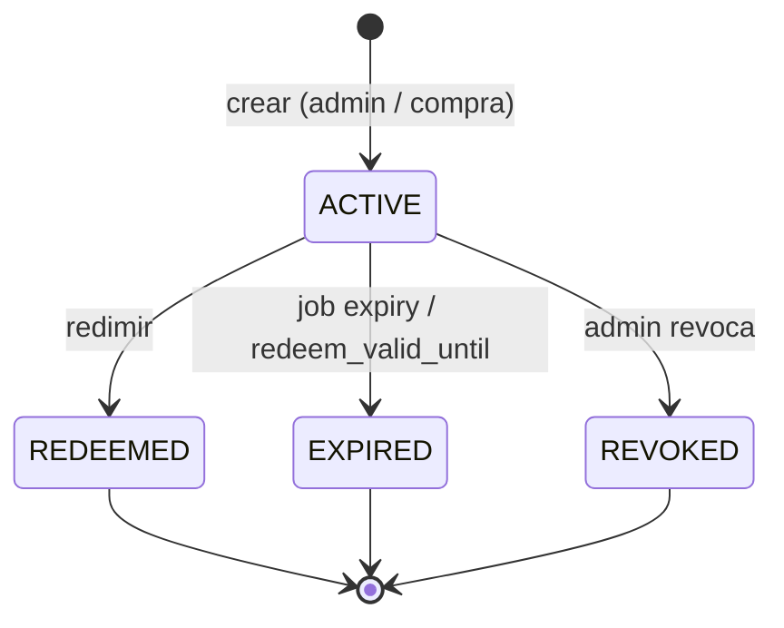

# Plan de Trabajo Promociones / Bonos — Resumen teórico (base)

> **Propósito de este documento.** Es la hoja de ruta única y compartida para
> incorporar el **core de promociones** (bonos regalo y bonos descuento) en la
> plataforma WMS SaaS. Está escrito para que **cualquier colega del equipo**
> entienda qué se va a construir, por qué, en qué orden, cómo se separa de
> billing / feature flags / parámetros, y cómo encaja en la arquitectura existente.
>
> **Cómo se usa.** Este archivo contiene la parte **teórica** (contexto, glosario,
> fronteras, arquitectura, ciclo de vida, reglas de negocio y mapa de fases).
> Cada fase de construcción vive en su propio archivo dentro de
> `docs/plan-promotions/`. Marca `[x]` cuando una actividad esté **terminada y
> verificada** (ver *Definición de Done* de cada fase).

---

## Índice

### Teoría (este archivo)

1. [Contexto y objetivo](#1-contexto-y-objetivo)
2. [Glosario](#2-glosario)
3. [Fronteras con capas existentes](#3-fronteras-con-capas-existentes)
4. [Principios de arquitectura](#4-principios-de-arquitectura)
5. [Tipos de bono y reglas de negocio](#5-tipos-de-bono-y-reglas-de-negocio)
6. [Alcance (targeting) y serial](#6-alcance-targeting-y-serial)
7. [Ciclo de vida y estados](#7-ciclo-de-vida-y-estados)
8. [Flujos de consumo](#8-flujos-de-consumo)
9. [Correos y plantillas](#9-correos-y-plantillas)
10. [Integración con billing y facturación](#10-integración-con-billing-y-facturación)
11. [Mapa de fases (resumen)](#11-mapa-de-fases-resumen)
12. [Decisiones acordadas](#12-decisiones-acordadas)
13. [Bitácora de decisiones](#13-bitácora-de-decisiones)

### Fases de construcción (un archivo cada una)

- [FASE 1 — Dominio backend y APIs](fase-1-dominio-backend.md)
- [FASE 2 — Suite de tests (matriz exhaustiva)](fase-2-tests.md)
- [FASE 3 — Administración plataforma (`base-admin-web`)](fase-3-admin-web.md)
- [FASE 4 — Redención cliente (`base-client-web`)](fase-4-client-redencion.md)
- [FASE 5 — Compra pública y landing (`base-landing-web` + ruta pública)](fase-5-compra-publica.md)

---

## 1. Contexto y objetivo

**base** es el backend de un WMS SaaS multi-tenant. Hoy existe un stack
maduro de **suscripciones, cobros, facturas y renovaciones**, pero **no existe**
dominio de promociones, cupones ni bonos.

**Objetivo de este plan:** construir un core de promociones que permita:

- **Admin (base-admin-web):** crear y listar bonos desde Suscripciones → pestaña
  Promociones (tabla al estilo Communications).
- **Bono regalo (`GIFT`):** otorgar una suscripción por **N meses** sin cobro.
- **Bono descuento (`DISCOUNT`):** otorgar un **porcentaje** sobre una o varias
  suscripciones.
- **Alcance configurable:** empresa(s) específica(s), genérico abierto, o
  genérico de un solo uso global (primera empresa que redime).
- **Vigencia de redención:** ventana para usar el serial; si vence sin uso →
  `EXPIRED` (permanece en registro).
- **Redención en cliente:**
  - Onboarding (paso de pago): aplicar serial al elegir plan.
  - Settings (empresa existente): redimir bono en apartado Suscripción.
- **Compra pública (fase 5):** desde landing → formulario público en client-web
  para comprar y regalar un bono (pago único, sin almacenar tarjeta).

**No-objetivos (lo que este plan NO hace):**

- No reemplaza `core/flags` (release toggles).
- No reemplaza `core/access` (entitlements de plan).
- No confunde `MethodType.VOUCHER` del gateway de pagos (medio de cobro
  efectivo/PSE) con bonos promocionales — dominio distinto, naming explícito.
- No implementa marketplace de promociones de terceros.
- No permite que una empresa tenga **más de un bono activo** a la vez: si ya
  existe un `PromotionBenefit` activo, debe rechazarse una nueva redención hasta
  que el beneficio actual termine (ver §4.2 y §12).

---

## 2. Glosario

| Concepto | Qué es | Dónde vive |
|----------|--------|------------|
| **Bono / Voucher** | Código promocional con serial único, tipo, reglas y estado | `platform/features/billing/promotion/` (schema `public`) |
| **Serial** | Identificador que ingresa el usuario (`WLGX-…`) | Campo único en `PromotionVoucher` |
| **Tipo `GIFT`** | Suscripción gratuita por N meses sobre plan(es) configurados | Enum `VoucherType.GIFT` |
| **Tipo `DISCOUNT`** | Porcentaje de descuento sobre plan(es) configurados | Enum `VoucherType.DISCOUNT` |
| **Vigencia de redención** | `redeem_valid_from` / `redeem_valid_until` — ventana para usar el serial | Modelo voucher |
| **Vigencia del beneficio** | Solo `GIFT`: meses gratis **después** de redimir (`benefit_months`) | Modelo voucher |
| **Alcance `COMPANY`** | Bono dedicado a una o más empresas (cada una recibe serial propio) | `VoucherScope.COMPANY` |
| **Alcance `OPEN`** | Cualquier empresa puede redimir mientras esté activo | `VoucherScope.OPEN` |
| **Alcance `FIRST_TAKE`** | Genérico; la primera redención lo consume para siempre | `VoucherScope.FIRST_TAKE` |
| **Redención** | Evento que aplica el bono a una empresa (`PromotionRedemption`) | Tabla de auditoría |
| **Origen `ADMIN`** | Bono creado por operador de plataforma (sin cobro) | `VoucherOrigin.ADMIN` |
| **Origen `PUBLIC_PURCHASE`** | Bono comprado vía flujo público (fase 5) | `VoucherOrigin.PUBLIC_PURCHASE` |
| **Plantilla `GIFT_VOUCHER`** | Email al destinatario empresa (bono dedicado) | `communication/email_template` |
| **Plantilla `DISCOUNT_VOUCHER`** | Email al destinatario empresa (bono dedicado) | `communication/email_template` |

---

## 3. Fronteras con capas existentes

```
Request cliente / admin
  1. Auth (JWT / cookie onboarding / admin)
  2. Suscripción / plan (core/access)     → si deniega capacidad, fin
  3. Validar y redimir bono (promotions)  → ajusta precio / plan temporal
  4. Cobro (billing/payments)             → monto ya ajustado
  5. CompanySubscription                  → vigencia / pending_subscription
```

| Capa | Relación con promociones |
|------|--------------------------|
| `platform/features/billing/subscription/` | Planes aplicables; upgrade/downgrade temporal con gift superior |
| `platform/features/billing/payments/` | Cobro con monto descontado; compra pública fase 5 |
| `platform/features/billing/invoice/` | Línea de descuento en factura (fase 1 incluye extensión mínima) |
| `client/features/security/onboarding/` | Paso suscripción/pago: validar serial |
| `platform/features/communication/` | Envío de emails post-creación / post-compra |
| `core/access` | Independiente; se ejecuta **antes** de redimir |
| `core/flags` | Opcional: `promotions.public_purchase` para liberar fase 5 |

---

## 4. Principios de arquitectura

### 4.1 Hexagonal / DDD (como el resto de platform)

```
platform/features/billing/promotion/
├── models.py
├── domain/
│   ├── schemas.py       # CreateVoucherSchema, RedeemVoucherSchema, …
│   └── interfaces.py    # IPromotionVoucherRepository, …
├── application/
│   └── use_cases.py     # CreateVoucher, ValidateVoucher, RedeemVoucher, ExpireVouchers, …
├── infrastructure/
│   └── repositories.py
├── presentation/
│   ├── api.py           # Admin + tenant + público (fase 5)
│   ├── serializers.py
│   ├── bodies.py
│   └── urls.py
├── tasks/
│   └── expiry.py        # Celery: marcar EXPIRED
└── migrations/
```

### 4.2 Reglas transversales

- **Un serial = un bono = una redención máxima** (salvo revocación admin antes de uso).
- **Una empresa = un beneficio activo máximo:** si la empresa ya tiene un
  `PromotionBenefit` en estado `ACTIVE`, no puede redimir otro bono hasta que
  el actual finalice (`PROMO_011`).
- **Idempotencia** en redención: reintentos con mismo serial + empresa no duplican efecto.
- **Fail-safe en emails:** envío best-effort; no revierte creación/redención.
- **Auditoría:** `audit_log` en create/revoke/redeem; `PromotionRedemption` inmutable.
- **Errores:** códigos `PROMO_*` en `core/errors/codes.py` + `syncerrors`.
- **Respuestas API:** `wrap_response()` estándar.

### 4.3 Naming — evitar colisión con payments

| Evitar | Usar |
|--------|------|
| `Voucher` en `payments.MethodType` | `PromotionVoucher`, `promo_serial` |
| `voucher_code` en charge metadata | `promotion_redemption_id` |

---

## 5. Tipos de bono y reglas de negocio

### 5.1 Bono regalo (`GIFT`)

| Contexto | Comportamiento |
|----------|----------------|
| **Onboarding** — plan coincide con gift | Suscripción queda en **$0** en ese momento; `benefit_months` meses sin cobro |
| **Onboarding** — plan superior al gift | **No aplica** (solo planes configurados en el bono) |
| **Empresa existente** — mismo plan | **N meses** sin cobro de renovación (`benefit_months`) |
| **Empresa existente** — plan superior al actual | Upgrade inmediato; al terminar `benefit_months` → **revertir** al plan anterior vía `pending_subscription` / job de fin de beneficio |
| **Empresa existente** — plan inferior | **Rechazado** (`PROMO_003`) |
| **Empresa con beneficio activo** | **Rechazado** (`PROMO_011`) — no puede redimir otro bono |

En empresa existente el gift cubre exactamente **`benefit_months` meses** de
beneficio (cuando `benefit_months = 1`, equivale a un solo ciclo sin cobro).

### 5.2 Bono descuento (`DISCOUNT`)

| Campo | Descripción |
|-------|-------------|
| `discount_percent` | 1–100 |
| `subscription_ids` | Una o varias suscripciones del catálogo |
| `discount_duration_months` | Meses que aplica el % en renovaciones (default `1`) |

| Contexto | Comportamiento |
|----------|----------------|
| **Onboarding** | Descuenta % del precio del plan elegido si está en la lista |
| **Empresa existente — upgrade** | Descuenta % del cargo de upgrade si el plan destino está en la lista |
| **Empresa existente — plan actual** | **Asunción:** aplica al próximo cobro de renovación si el plan actual está en la lista |

Si el bono incluye varios planes, el usuario **elige uno** al redimir (el que
seleccione debe estar en la lista).

### 5.3 Creación masiva (admin)

Al seleccionar varias empresas o **todas las empresas existentes**:

- Se genera **un bono independiente por empresa** (serial único cada uno).
- Misma configuración (tipo, planes, %, meses, vigencia de redención).
- Email `GIFT_VOUCHER` / `DISCOUNT_VOUCHER` **por cada empresa** (alcance `COMPANY`).
- Empresas creadas **después** no reciben bono retroactivo (“todas” = snapshot al crear).

---

## 6. Alcance (targeting) y serial

### 6.1 Modos de alcance

| Modo | Creación admin | Redención |
|------|----------------|-----------|
| `COMPANY` | FK a `company_id` (una empresa por registro) | Solo esa empresa |
| `OPEN` | Sin empresa | Cualquier empresa autenticada / onboarding |
| `FIRST_TAKE` | Sin empresa | Primera redención gana; luego `REDEEMED` global |

### 6.2 Formato de serial (propuesta)

```
WLGX-{TYPE}-{8 chars alfanuméricos}
Ejemplo: WLGX-GFT-A7K9M2X1
         WLGX-DSC-B3N8P4Q2
```

- Generado automáticamente; no editable en MVP.
- Índice único case-insensitive.

---

## 7. Ciclo de vida y estados



| Estado | Descripción |
|--------|-------------|
| `ACTIVE` | Puede redimirse si está en ventana de vigencia |
| `REDEEMED` | Ya consumido; registro histórico |
| `EXPIRED` | Vigencia de redención venció sin uso |
| `REVOKED` | Anulado por admin antes de redimir |

**Job Celery `expire_promotion_vouchers`:** diario; marca `EXPIRED` donde
`status=ACTIVE` y `redeem_valid_until < now()`.

---

## 8. Flujos de consumo

### 8.1 Admin — crear y listar

`base-admin-web` → pestaña **Promociones** en `/admin/subscriptions` → tabla con
filtros (tipo, estado, empresa, vigencia) → modal crear (simple o masivo).

### 8.2 Onboarding — aplicar bono

```
subscription step → (opcional) validar serial
payment step    → UI "Aplicar bono" + serial
                → precio ajustado ($0 si gift cubre 100%)
                → SIEMPRE capturar medio de pago (aunque monto = $0)
finalize        → cobro real (monto ajustado) + redención + CompanySubscription
```

### 8.3 Settings — redimir bono

`/security/settings` → tab Suscripción → "Redimir bono" → serial → preview de
efecto → confirmar → API tenant `POST …/promotions/redeem/`.

### 8.4 Compra pública (fase 5)

```
base-landing-web CTA → base-client-web ruta pública
  Step 1: Detalle del bono (tipo GIFT o DISCOUNT, plan, meses/%)
  Step 2: Datos comprador
  Step 3: Datos destinatario (inputs libres, sin datos de la base)
  Step 4: Medio de pago (token único, no persistir PaymentMethod)
  → cobro → generar bono OPEN (GIFT o DISCOUNT) → emails → pantalla serial
```

---

## 9. Correos y plantillas

| Código | Cuándo | Destinatarios |
|--------|--------|---------------|
| `GIFT_VOUCHER` | Creación admin con alcance `COMPANY` | Email empresa |
| `DISCOUNT_VOUCHER` | Creación admin con alcance `COMPANY` | Email empresa |
| `GIFT_VOUCHER_PURCHASE` | Compra pública gift (fase 5) — **nueva** | Destinatario |
| `DISCOUNT_VOUCHER_PURCHASE` | Compra pública discount (fase 5) — **nueva** | Destinatario |
| `VOUCHER_PURCHASE_CONFIRM` | Compra pública (fase 5) — **nueva** | Comprador |

Contexto mínimo: `serial`, `voucher_type`, `subscription_name`, `benefit_months`
o `discount_percent`, `redeem_valid_until`, `company_name` (si aplica).

**Regla del requerimiento:** email con plantillas `GIFT_VOUCHER` /
`DISCOUNT_VOUCHER` **solo** cuando el bono es para empresa particular (admin).
Compra pública usa plantillas dedicadas.

---

## 10. Integración con billing y facturación

### 10.1 Puntos de enganche

| Hook | Acción |
|------|--------|
| `CreateChargeUseCase` / `charge_plan()` | Aceptar `adjusted_amount` + `promotion_redemption_id` en metadata |
| `ChangeSubscriptionUseCase` | Gift superior → plan temporal + fecha fin beneficio |
| `renew_subscription` | Saltar cobro si hay beneficio gift activo; aplicar % descuento si redemption activa |
| `invoice_context.py` | `original_amount`, `discount_amount`, **anexo del bono** (serial, tipo, %) |
| `finalize` onboarding | Cobro real conectado; captura tarjeta siempre; monto ajustado post-bono (puede ser $0) |

### 10.2 Modelo auxiliar `PromotionBenefit` (propuesta)

Registro activo post-redención: empresa, voucher, fecha inicio/fin beneficio,
plan aplicado, plan anterior (si upgrade temporal). Usado por renovaciones y job
de reversión.

---

## 11. Mapa de fases (resumen)

| Fase | Entregable | Repos |
|------|------------|-------|
| **1** | Dominio, modelos, APIs admin/validate/redeem, emails empresa, job expiry, hooks billing | `base` |
| **2** | Matriz exhaustiva de tests unitarios + integración API | `base` |
| **3** | UI admin Promociones (tabla + CRUD + masivo) | `base-admin-web` |
| **4** | Redención onboarding + settings | `base-client-web` |
| **5** | Landing CTA + flujo público compra/regalo + pago | `base-landing-web`, `base-client-web`, APIs públicas |

**Dependencias:**

```
Fase 1 ──► Fase 2 (tests en paralelo posible desde mitad de Fase 1)
Fase 1 ──► Fase 3, Fase 4
Fase 1 + billing estable ──► Fase 5
```

---

## 12. Decisiones acordadas

| # | Tema | Decisión |
|---|------|----------|
| D1 | Gift empresa existente | **N meses** exactos (`benefit_months` del bono) |
| D2 | Descuento | Aplica en **N renovaciones** (`discount_duration_months`) |
| D3 | Onboarding con monto $0 | **Siempre** solicitar medio de pago (no omitir paso) |
| D4 | Bonos simultáneos por empresa | **No** — una empresa con beneficio activo no puede redimir otro bono (`PROMO_011`) |
| D5 | Revocación admin | **Sí** — bonos `ACTIVE` revocables desde admin |
| D6 | Serial | **Auto-generado** aleatorio (`WLGX-…`) |
| D7 | Facturación | **Sí** — factura con desglose y **anexo del bono** (serial, tipo, montos) |
| D8 | Onboarding cobro real | **Sí** — conectar cobro en `finalize` (Fase 1) |
| D9 | Compra pública | **GIFT y DISCOUNT** — ambos tipos comprables para regalar |
| D10 | UI admin | **Apartado Promociones** dentro de la pantalla Suscripciones; **sin cambios en sidebar** |

---

## 13. Bitácora de decisiones

| Fecha | Decisión | Notas |
|-------|----------|-------|
| 2026-07-07 | Plan documentado | Versión inicial |
| 2026-07-07 | D1–D10 cerradas | Validación negocio — ver §12 |
| | | |

---

## Comandos útiles (post-implementación)

```bash
# Tests promociones
pytest platform/tests/unit/billing/promotion/ -m unit
pytest platform/tests/integration/billing/promotion/ -m integration
pytest -m api -k promotion

# Job expiry (manual)
python manage.py expire_promotion_vouchers

# Sincronizar errores i18n
python manage.py syncerrors
```
