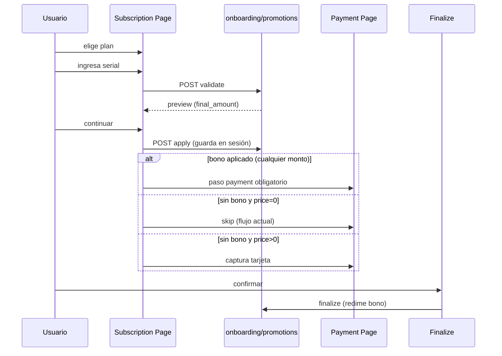

# FASE 4 — Redención cliente (`base-client-web`)

> **Navegación:** [Resumen teórico](00-resumen-teorico.md) · ← [Fase 3](fase-3-admin-web.md) · **Fase 4** · Siguiente → [Fase 5](fase-5-compra-publica.md)

> **Continuidad — qué se hizo en las Fases 1–3.** Backend con validate/redeem y
> hooks de onboarding; admin operativo. Esta fase expone la redención al usuario
> final en registro y en configuración de suscripción.

**Objetivo:** permitir aplicar/redimir bonos en el wizard de onboarding (paso
pago/suscripción) y en `/security/settings` → Suscripción, con preview de efecto
y mensajes de error i18n (`PROMO_*`).

---

## Alcance

| Flujo | Ruta | Auth |
|-------|------|------|
| Onboarding — aplicar bono | `/security/register/subscription` y/o `/security/register/payment` | cookie onboarding |
| Settings — redimir bono | `/security/settings` tab subscription | JWT tenant |

**Fuera de alcance:** compra pública (Fase 5).

---

## Archivos a crear/modificar

### Nuevos

| Archivo | Rol |
|---------|-----|
| `feature/billing/promotions/services/promotion.service.ts` | validate + redeem tenant |
| `feature/billing/promotions/interfaces/promotion.interfaces.ts` | tipos |
| `feature/billing/promotions/components/voucher-apply/voucher-apply.component.ts` | input serial + preview |
| `feature/security/register/components/voucher-apply-onboarding/` | wrapper onboarding |

### Modificar

| Archivo | Cambio |
|---------|--------|
| `register/services/onboarding.service.ts` | `validatePromotion`, `applyPromotion` |
| `register/interfaces/onboarding.interfaces.ts` | `applied_voucher`, `adjusted_price` |
| `register/pages/subscription/register-subscription-page.*` | UI aplicar bono |
| `register/pages/payment/register-payment-page.*` | mostrar monto ajustado; **siempre** capturar tarjeta |
| `register/pages/confirmation/register-confirmation-page.*` | resumen descuento |
| `register/constants/register-flow.config.ts` | payment obligatorio si plan price>0 **o** bono aplicado |
| `settings/components/settings-subscription/settings-subscription.component.*` | sección Redimir bono |
| `assets/i18n/es/security.json` | textos promociones |
| `assets/i18n/es/errors.json` | PROMO_* (syncerrors) |

---

## Componente reutilizable `VoucherApplyComponent`

### Inputs

- `context: 'onboarding' | 'settings'`
- `subscriptionId?: string` — plan seleccionado
- `disabled?: boolean`

### Outputs

- `applied: PromotionPreview`
- `cleared: void`

### UX

1. Campo serial + botón "Aplicar" / "Validar".
2. Loading durante validate.
3. Preview card:
   - Tipo (Regalo / Descuento)
   - Plan aplicable
   - Precio original → precio final
   - Meses de beneficio o % y duración
   - Vigencia de redención
4. Botón quitar bono.
5. Errores con `NormalizedApiError` → i18n `errors.codes.PROMO_*`.

---

## Flujo onboarding



### Reglas UI

- Si hay **bono aplicado** → **siempre** mostrar paso payment (tarjeta), aunque
  `final_amount === 0`. Mensaje UX: "Medio de pago para renovaciones futuras".
- Si **sin bono** y plan gratis (`price === 0`) → omitir payment (comportamiento actual).
- `PlanSelectorComponent`: badge "Con bono" y precio tachado si preview activo.
- Persistir serial en `RegistrationService` para back-navigation.

### APIs

- `POST /api/v1/onboarding/promotions/validate/`
- `POST /api/v1/onboarding/promotions/apply/`

Body validate: `{ serial, subscription_id }`

---

## Flujo settings — redimir bono

Sección nueva en `SettingsSubscriptionComponent` debajo del plan actual:

```
┌─────────────────────────────────────┐
│ Plan actual: Pro                    │
│ … upgrade / cancel …                │
├─────────────────────────────────────┤
│ Redimir bono                        │
│ [ Serial____________ ] [Validar]    │
│ Preview…                            │
│ [ Confirmar redención ]             │
└─────────────────────────────────────┘
```

### Flujo

1. Usuario ingresa serial → `POST /api/v1/promotions/validate/` con
   `subscription_id` del plan destino (si upgrade) o actual.
2. Preview explica efecto:
   - Gift mismo plan: "N meses sin cobro"
   - Gift superior: "Upgrade a X por N meses, luego vuelves a Y"
   - Discount: "% en próximo cobro / upgrade"
3. Confirmar → `POST /api/v1/promotions/redeem/`
4. Toast éxito → refrescar sesión o `SessionService` reload si cambió plan.

### Restricciones UI (espejo backend)

- Si gift plan inferior al actual → error antes de confirmar.
- Si beneficio activo → deshabilitar redención (`PROMO_011`, mensaje claro).

---

## Feature flags (opcional)

Si se desea liberación gradual:

- `settings.subscription.redeem_voucher` en catálogo tenant features.
- Onboarding: parámetro plataforma `ONB_VOUCHER_ENABLED`.

MVP: visible sin flag si el endpoint responde.

---

## Actividades

- [x] `PromotionService` tenant + onboarding methods.
- [x] `VoucherApplyComponent` dumb/smart según convención del módulo.
- [x] Integrar en subscription page (onboarding).
- [x] Ajustar payment page (monto ajustado; tarjeta siempre si hay bono).
- [x] Ajustar confirmation (resumen bono).
- [x] `hydrateFromState` incluye voucher aplicado.
- [x] Settings: sección redimir + modal confirmación si upgrade.
- [x] i18n completo ES (+ EN si el proyecto lo exige en la feature).
- [x] Manejo errores PROMO_*.
- [x] Tests unitarios componente (mock service).
- [x] E2E `e2e/tests/promotions.spec.ts` (casos O1–O5 de Fase 2).

---

## Definición de Done — Fase 4

- [x] Onboarding: serial gift Pro → payment con tarjeta → finalize con PM + charge $0 (E2E O1).
- [x] Onboarding: serial discount 20% → payment muestra precio reducido (E2E O2).
- [x] Settings: redimir gift extiende beneficio (visible en UI o mensaje) (E2E O3).
- [x] Settings: gift superior muestra preview de reversión (E2E O8).
- [x] Settings: plan inferior rechazado con mensaje claro (E2E O7).
- [x] Serial inválido/expirado muestra error traducido (E2E O4, O5).
- [x] E2E happy path onboarding gift en verde (O1).
- [x] Settings: beneficio activo bloquea otro bono (E2E O6, PROMO_011).

> **Tests unitarios:** specs en `voucher-apply.component.spec.ts` y
> `registration.service.spec.ts`. `ng test` del proyecto aún falla por issues
> preexistentes (rxjs duplicado base-web-lib, `src/styles.css`); los specs compilan.

### Checklist QA manual

| # | Escenario | Esperado |
|---|-----------|----------|
| 1 | Registro + gift OPEN Pro | payment con tarjeta; tenant Pro; PM guardado |
| 2 | Registro + discount 50% | pago mitad |
| 3 | Settings gift mismo plan | confirmación éxito |
| 4 | Settings gift Basic teniendo Pro | error |
| 5 | Quitar bono antes de continuar | precio original |
| 6 | Back nav onboarding conserva serial | |
