# FASE 5 — Compra pública y landing (`base-landing-web` + ruta pública)

> **Navegación:** [Resumen teórico](00-resumen-teorico.md) · ← [Fase 4](fase-4-client-redencion.md) · **Fase 5**

> **Continuidad — qué se hizo en las Fases 1–4.** Core de promociones, redención
> admin y cliente. Esta fase habilita que **cualquier persona** compre un bono
> (regalo o descuento) desde la landing y lo envíe a un destinatario, sin crear
> cuenta de la base.

**Objetivo:** CTA "Regalar bono" en `base-landing-web` → formulario público multi-step
en `base-client-web` → pago único sin almacenar tarjeta → generación de bono `OPEN`
(`GIFT` o `DISCOUNT`) → emails a comprador y destinatario → pantalla final con serial.

**Alcance (D9):** compra pública de **Bono regalo** y **Bono descuento** para regalar.

---

## Arquitectura del flujo

```mermaid
flowchart LR
    L[base-landing-web CTA] -->|URL pública| C[base-client-web /public/gift-voucher]
    C --> S1[Detalle bono: GIFT o DISCOUNT]
    S1 --> S2[Datos comprador]
    S2 --> S3[Datos destinatario]
    S3 --> S4[Medio de pago]
    S4 --> API[POST public/promotions/purchase/checkout]
    API --> Pay[Gateway simulator]
    Pay --> V[Crear PromotionVoucher OPEN]
    V --> E[Emails + pantalla serial]
```



---

## base-landing-web

### Archivos

| Archivo | Cambio |
|---------|--------|
| `src/presentation/components/Navbar.astro` | CTA "Regalar bono" |
| `src/presentation/views/HomeView.astro` | sección estratégica opcional |
| `src/i18n/ui.ts` | textos ES/EN |
| `src/config/urls.ts` (crear si no existe) | `CLIENT_PUBLIC_GIFT_URL` |

### URL destino (propuesta)

```
http://app.base.local:4110/public/gift-voucher
```

Producción: `https://app.base.local/public/gift-voucher`

Configurable por env en landing.

---

## base-client-web — ruta pública

### Routing

| Ruta | Componente | Guard |
|------|------------|-------|
| `/public/gift-voucher` | `VoucherPurchasePageComponent` | ninguno (público) |
| `/public/gift-voucher/success` | `VoucherPurchaseSuccessPageComponent` | ninguno |

Registrar en `app-routing.module.ts` **fuera** de `authGuard`, similar a
`/security/register-start`.

### Módulo sugerido

```
feature/public/voucher-purchase/
├── pages/
│   ├── voucher-purchase-page/
│   └── voucher-purchase-success-page/
├── components/
│   ├── voucher-catalog-step/      # tipo GIFT | DISCOUNT
│   ├── gift-options-step/         # meses beneficio (si GIFT)
│   ├── discount-options-step/     # % y renovaciones (si DISCOUNT)
│   ├── buyer-info-step/
│   ├── recipient-info-step/
│   └── payment-step/
├── services/
│   └── public-voucher-purchase.service.ts
└── interfaces/
    └── voucher-purchase.interfaces.ts
```

---

## Steps del formulario

### Step 1 — Detalle del bono

| Campo | Control |
|-------|---------|
| Tipo de bono | radio **Regalo** / **Descuento** |
| Plan a regalar | cards (catálogo `GET /api/v1/subscriptions/`) |
| Meses de beneficio | select 1, 3, 6, 12 — **solo si GIFT** |
| % descuento | select 10, 20, 30, … — **solo si DISCOUNT** |
| Renovaciones con descuento | select 1, 3, 6 — **solo si DISCOUNT** |
| Precio | readonly desde `POST …/purchase/preview/` |

### Step 2 — Datos del comprador

| Campo | Validación |
|-------|------------|
| Nombre completo | requerido |
| Email | email válido |
| Teléfono | opcional |
| País | select |

**Sin** mostrar datos internos de la base.

### Step 3 — Datos del destinatario

| Campo | Validación |
|-------|------------|
| Nombre destinatario | requerido |
| Email destinatario | email válido |
| Mensaje personal | opcional, max 500 chars |
| Nombre empresa destino | opcional (texto libre) |

Inputs libres — **no** autocompletar empresas del sistema.

### Step 4 — Medio de pago

- Reutilizar UI tarjeta de `register-payment-page` (solo token).
- `processor_token` al gateway — **no** `POST payment-methods`.
- Checkbox términos y condiciones.

---

## Backend — APIs públicas (completar Fase 1 stub)

### `POST /api/v1/public/promotions/purchase/preview/`

**Gift:**
```json
{
  "voucher_type": "GIFT",
  "subscription_id": "uuid",
  "benefit_months": 3
}
```

**Discount:**
```json
{
  "voucher_type": "DISCOUNT",
  "subscription_id": "uuid",
  "discount_percent": 20,
  "discount_duration_months": 3
}
```

Response: `{ "amount": 299.00, "currency": "USD", "description": "…" }`

Precio desde tabla catálogo configurable (ver abajo).

### `POST /api/v1/public/promotions/purchase/checkout/`

```json
{
  "voucher_type": "GIFT",
  "subscription_id": "uuid",
  "benefit_months": 3,
  "buyer": { "name", "email", "phone?", "country?" },
  "recipient": { "name", "email", "message?", "company_name?" },
  "payment": { "processor_token", "holder", "last4", "expiry_month", "expiry_year" },
  "idempotency_key": "uuid"
}
```

(`voucher_type: "DISCOUNT"` incluye `discount_percent` y `discount_duration_months`.)

Response:

```json
{
  "voucher_serial": "WLGX-GFT-…",
  "redeem_valid_until": "2026-12-31T23:59:59Z",
  "amount_paid": 299.00
}
```

### Lógica checkout

1. Validar catálogo y precio.
2. Crear `Charge` one-shot (sin `PaymentMethod` persistido).
3. Si cobro OK → `PromotionVoucher` `OPEN`, `origin=PUBLIC_PURCHASE`, tipo según
   request (`GIFT` o `DISCOUNT`), metadata comprador/destinatario.
4. Vigencia redención: default 12 meses desde compra (parámetro `PROMO_PUBLIC_REDEEM_MONTHS`).
5. Emails best-effort.
6. Idempotente por `idempotency_key`.

---

## Catálogo de precios regalo (platform)

Tabla opcional `VoucherPurchaseCatalog` o JSON en parámetro plataforma:

**Gift:**

| subscription_id | benefit_months | price |
|-----------------|----------------|-------|
| Pro | 3 | 299 |
| Pro | 6 | 549 |

**Discount:**

| subscription_id | discount_percent | discount_duration_months | price |
|-----------------|------------------|--------------------------|-------|
| Pro | 20 | 3 | 149 |
| Enterprise | 30 | 6 | 399 |

Admin puede gestionarse en fase posterior; MVP: parámetro `PROMO_GIFT_CATALOG_JSON`.

---

## Emails (nuevas plantillas)

| Código | Destinatario | Contenido |
|--------|--------------|-----------|
| `GIFT_VOUCHER_PURCHASE` | Destinatario | serial, plan, meses, mensaje, vigencia |
| `DISCOUNT_VOUCHER_PURCHASE` | Destinatario | serial, plan, %, renovaciones, vigencia |
| `VOUCHER_PURCHASE_CONFIRM` | Comprador | recibo, serial, tipo, destinatario email |

Distintas de `GIFT_VOUCHER` (empresa dedicada admin).

---

## Pantalla éxito

`/public/gift-voucher/success?serial=…` (o state en memory)

Mostrar:

- Serial grande + botón copiar
- Resumen compra
- "Enviamos el bono a {recipient_email}"
- CTA "Regalar otro" / "Ir al inicio"

---

## Seguridad

| Riesgo | Mitigación |
|--------|------------|
| Abuso checkout | rate limit IP + captcha (fase posterior) |
| PII en logs | redacción `logging_redaction` |
| Fraude tarjeta | gateway real en prod; simulator en dev |
| Enumeration serial | no endpoint list público |

---

## Actividades

### base

- [x] Implementar preview + checkout públicos.
- [x] Catálogo precios regalo (`PROMO_GIFT_CATALOG_JSON`).
- [x] Charge one-shot sin PaymentMethod.
- [x] Dispatcher emails compra (`GIFT_VOUCHER_PURCHASE`, `DISCOUNT_VOUCHER_PURCHASE`, `VOUCHER_PURCHASE_CONFIRM`).
- [x] Tests M1–M8 (API + unit catálogo; integration requiere DB limpia).
- [ ] CORS/rate limit si aplica.

### base-client-web

- [x] Módulo público gift-voucher + routing (`/public/gift-voucher`).
- [x] Wizard 4 steps.
- [x] Integración preview/checkout.
- [x] Success page con serial.
- [x] i18n ES/EN (`public.json`).
- [x] Responsive mobile (layout base).

### base-landing-web

- [x] CTA Navbar + copy i18n.
- [x] URL configurable a client público (`SITE.links.giftVoucher`).
- [x] Sección marketing opcional en Home (`GiftVoucher.astro`).

---

## Definición de Done — Fase 5

- [x] Landing enlaza a formulario público funcional.
- [ ] Compra completa en dev (simulator) genera serial.
- [ ] Emails comprador + destinatario enviados (mock/log).
- [ ] Tarjeta no aparece en `payment_methods`.
- [x] Bono redimible en onboarding/settings (Fase 4).
- [x] Tests M1–M8 en verde (API ✓; E2E client ✓; integration depende de Postgres test DB).
- [x] Idempotencia checkout verificada (mock E2E + integration).

### Checklist QA end-to-end

| # | Paso | Esperado |
|---|------|----------|
| 1 | Click CTA landing | abre client público |
| 2 | Elegir Pro 3 meses | precio preview |
| 3 | Completar comprador/destinatario | avanza steps |
| 4 | Pagar simulator OK | success + serial |
| 5 | Email destinatario | contiene serial |
| 6 | Redimir serial en registro nuevo tenant | gift aplica |
| 7 | Reintentar checkout mismo idempotency | no duplica voucher |
| 8 | Pago fallido | sin voucher, mensaje error |

**Seed plantillas email (ops):**

```bash
python manage.py seed_promotion_email_templates
python manage.py seed_promotion_email_templates --dry-run
```

**Variables `.env` (prod):**

- `PROMO_PUBLIC_BILLING_COMPANY_ID` — UUID de company en schema público para cargos one-shot (dev: fallback primera company).
- `PROMO_GIFT_CATALOG_JSON` — opcional; default incluye PRO 3/6 meses y descuento 20%×3.

---

## Fuera de MVP (backlog)

- Admin UI para catálogo precios compra pública.
- PDF regalo descargable.
- QR en email con deep link a registro con serial prellenado.
